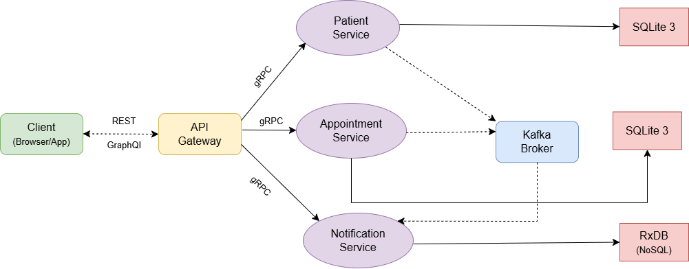
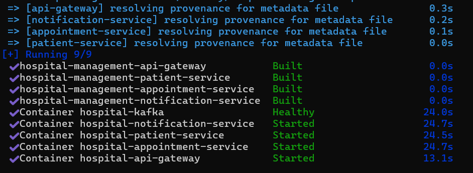
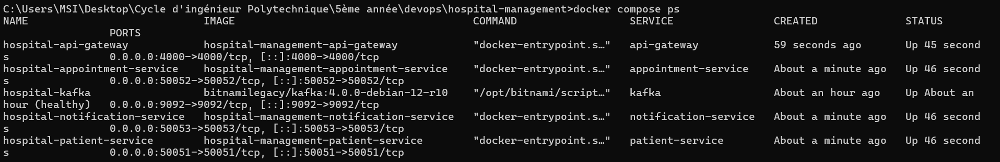
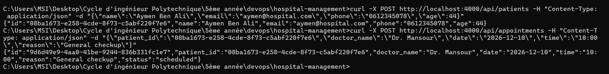
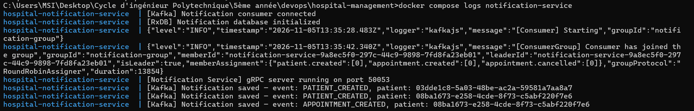
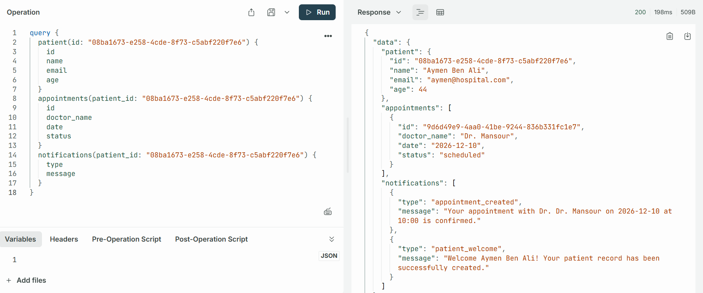
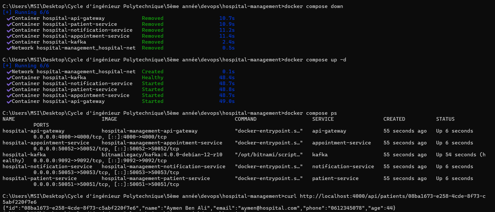
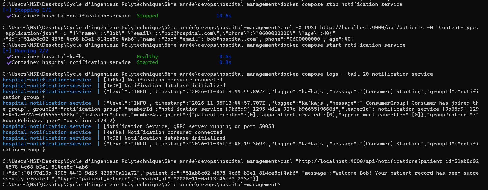

# Smart Hospital Management System

## Table of Contents

- [Project Description](#-project-description)
- [Architecture](#-architecture)
- [Services Overview](#-services-overview)
- [Kafka Topics](#-kafka-topics)
- [Project Structure](#-project-structure)
- [Containerization](#-containerization)
- [Installation & Setup](#-installation--setup)
- [Docker Commands: Build, Start, Diagnose, Stop](#-docker-commands-build-start-diagnose-stop)
- [Tests Performed](#-tests-performed)
- [Difficulties and Solutions](#-difficulties-and-solutions)
- [REST API Reference](#-rest-api-reference)
- [GraphQL API Reference](#-graphql-api-reference)
- [Proto Files](#-proto-files)
- [Databases](#-databases)
- [Technologies Used](#-technologies-used)
- [Authors](#-authors)

---

## Project Description

The **Smart Hospital Management System** is a distributed application built with a microservices architecture using **Node.js exclusively**. The system handles patient registration, appointment booking and cancellation, and automated notifications through three independent microservices.

The project demonstrates:
- Clear separation of responsibilities between microservices
- Synchronous communication via **gRPC over HTTP/2 with Protobuf**
- Asynchronous event-driven communication via **Apache Kafka 4.0**
- A unified API entry point exposing both **REST** and **GraphQL** interfaces
- Independent databases per microservice (**SQLite3** and **RxDB**)
- Full containerization with **Docker and Docker Compose**

---

## Architecture



The application follows this architecture:

- The **Client** (browser or app) communicates with the **API Gateway** using REST and GraphQL over HTTP/1.1 with JSON
- The **API Gateway** is the single entry point — it translates REST and GraphQL requests into **gRPC calls** directed to the appropriate microservice over HTTP/2
- The **3 microservices** each expose a gRPC interface, own their database, and communicate asynchronously through the **Kafka Broker**
- **Patient Service** and **Appointment Service** publish events to Kafka topics
- **Notification Service** consumes all Kafka topics and stores notifications in RxDB

---

## Services Overview

| Service | Responsibility | Interface | Port | Database |
|---|---|---|---|---|
| API Gateway | Single entry point — REST + GraphQL | HTTP/1.1 + GraphQL | 4000 | None |
| Patient Service | Create and manage patient records | gRPC / HTTP/2 | 50051 | SQLite3 |
| Appointment Service | Book and cancel appointments | gRPC / HTTP/2 | 50052 | SQLite3 |
| Notification Service | Store and serve event notifications | gRPC / HTTP/2 | 50053 | RxDB (NoSQL) |
| Kafka Broker | Asynchronous event bus | Kafka 4.0 KRaft | 9092 | — |

---

## Kafka Topics

| Topic | Producer | Consumer | Triggered When |
|---|---|---|---|
| `patient.created` | Patient Service | Notification Service | A new patient is registered |
| `appointment.created` | Appointment Service | Notification Service | An appointment is booked |
| `appointment.cancelled` | Appointment Service | Notification Service | An appointment is cancelled |

### Kafka Event Flow

```
1. Client creates a patient or books/cancels an appointment
2. The service saves the data to its own database (SQLite3)
3. The service publishes a JSON event to the corresponding Kafka topic
4. The service immediately responds to the API Gateway (non-blocking)
5. Meanwhile, Notification Service receives the event from Kafka
6. Notification Service saves the notification to RxDB
```

> Kafka ensures services are fully decoupled. Patient Service and Appointment Service do not know Notification Service exists. If Notification Service is down, messages wait in Kafka — nothing is lost.

---

##  Project Structure

```
hospital-management/
│
├── proto/
│   ├── patient.proto            # gRPC contract: Patient Service
│   ├── appointment.proto        # gRPC contract: Appointment Service
│   └── notification.proto       # gRPC contract: Notification Service
│
├── api-gateway/
│   ├── src/
│   │   ├── index.js             # Express server: REST routes + Apollo GraphQL
│   │   ├── grpcClients.js       # gRPC client stubs for all 3 microservices
│   │   ├── schema.js            # GraphQL type definitions
│   │   └── resolvers.js         # GraphQL resolvers: call gRPC clients
│   ├── Dockerfile
│   ├── .dockerignore
│   └── package.json
│
├── patient-service/
│   ├── src/
│   │   ├── index.js             # gRPC server: patient CRUD logic
│   │   ├── db.js                # SQLite3 database initialization
│   │   └── KafkaProducer.js     # Publishes patient.created to Kafka
│   ├── data/                    # SQLite3 database file (persisted via bind mount)
│   ├── Dockerfile
│   ├── .dockerignore
│   └── package.json
│
├── appointment-service/
│   ├── src/
│   │   ├── index.js             # gRPC server: appointment logic
│   │   ├── db.js                # SQLite3 database initialization
│   │   └── KafkaProducer.js     # Publishes appointment.created / cancelled
│   ├── data/                    # SQLite3 database file (persisted via bind mount)
│   ├── Dockerfile
│   ├── .dockerignore
│   └── package.json
│
├── notification-service/
│   ├── src/
│   │   ├── index.js             # gRPC server: list notifications
│   │   ├── db.js                # RxDB in-memory database initialization
│   │   └── KafkaConsumer.js     # Consumes patient.created, appointment.*
│   ├── Dockerfile
│   ├── .dockerignore
│   └── package.json
│
├── screenshots/                 # Screenshots of the build, tests and results
├── docker-compose.yml           # Orchestrates all 5 containers
├── .gitignore                   # Excludes node_modules, .db files, .env
└── README.md
```

> File names are case-sensitive inside the Linux containers: `KafkaProducer.js` and `KafkaConsumer.js` must be required with exactly that spelling (see [Difficulties and Solutions](#-difficulties-and-solutions)).

---

## Containerization

### Dockerfiles

Each of the four Node.js services has its own `Dockerfile` and `.dockerignore`.

```dockerfile
FROM node:20-alpine
WORKDIR /app
COPY package*.json ./
RUN npm install --omit=dev      # dependencies first, for layer caching
COPY src/ ./src/
EXPOSE <service port>
CMD ["node", "src/index.js"]
```

- The patient and appointment services also run `mkdir -p /app/data` for their SQLite file.
- `.dockerignore` excludes `node_modules`, `npm-debug.log`, `.env`, `.git` and `data`, so the images stay small and local files never leak into them.

### docker-compose.yml

| Element | Configuration |
|---|---|
| **Network** | One bridge network, `hospital-net`. Containers reach each other by **service name** (`kafka`, `patient-service`, ...). |
| **Ports published to the host** | `4000` (API gateway), `50051-50053` (gRPC, for debugging), `9092` (Kafka) |
| **Environment variables** | `GRPC_PORT`, `KAFKA_BROKER=kafka:9092`, `DB_PATH`; gateway: `PORT`, `PATIENT_SERVICE_URL=patient-service:50051`, `APPOINTMENT_SERVICE_URL=appointment-service:50052`, `NOTIFICATION_SERVICE_URL=notification-service:50053` |
| **Dependencies** | The three microservices wait for Kafka to be `healthy` (`depends_on: condition: service_healthy`); the gateway waits for the three services to start |
| **Healthcheck** | Kafka: `kafka-topics.sh --bootstrap-server localhost:9092 --list` (every 15 s, 30 s start period, 10 retries) |
| **Persistent storage** | Named volume `kafka-data` (Kafka logs); bind mounts `./patient-service/data` and `./appointment-service/data` (SQLite files) |
| **Shared contracts** | `./proto` is mounted read-write at `/proto` in the gateway and in each microservice |
| **Restart policy** | `unless-stopped` |

---

## Installation & Setup

### Prerequisites

- [Docker Desktop](https://www.docker.com/products/docker-desktop/) installed and **running** (wait for "Engine running")
- [Git](https://git-scm.com/)

### Clone and Run

```bash
# 1 — Clone the repository
git clone https://github.com/AmalMselmi/hospital-management.git
cd hospital-management

# 2 — Build and start all containers in the background
docker compose up -d --build

# 3 — Check the status (Kafka takes 30-60 s to become healthy)
docker compose ps
```

The `data/` folders for SQLite are created automatically on first start.

Once everything is up, the logs show:

```
hospital-patient-service       | [Patient Service] gRPC server running on port 50051
hospital-appointment-service   | [Appointment Service] gRPC server running on port 50052
hospital-notification-service  | [Kafka] Notification consumer connected
hospital-notification-service  | [Notification Service] gRPC server running on port 50053
hospital-api-gateway           | [API Gateway] HTTP server running on port 4000
```




### Access Points

| Interface | URL |
|---|---|
| REST API | http://localhost:4000/api/ |
| GraphQL Sandbox | http://localhost:4000/graphql |
| Health Check | http://localhost:4000/health |

---

## Docker Commands: Build, Start, Diagnose, Stop

### Build

```bash
docker compose config                        # validate docker-compose.yml
docker compose build                         # build all images
docker compose build notification-service    # build a single service
```

### Start

```bash
docker compose up -d --build                 # build and start everything in the background
docker compose up -d --build <service>       # rebuild and restart one service after a code change
docker compose start | stop | restart <service>
```

### Diagnose

```bash
docker compose ps                            # status of all services (Up / healthy / Restarting)
docker compose logs -f                       # follow all logs (Ctrl+C to exit)
docker compose logs -f notification-service  # follow one service
docker compose logs --tail 50 patient-service

docker compose exec api-gateway sh           # open a shell in a container
docker compose exec api-gateway nslookup patient-service            # check DNS between services
docker compose exec kafka kafka-topics.sh --bootstrap-server localhost:9092 --list
docker compose exec kafka kafka-console-consumer.sh --bootstrap-server localhost:9092 --topic patient.created --from-beginning --timeout-ms 5000

docker network ls
docker network inspect hospital-management_hospital-net
docker volume ls
```

### Stop

```bash
docker compose stop        # stop the containers, keep them
docker compose down        # stop and remove the containers and the network (data is kept)
docker compose down -v     # also removes the named volume kafka-data
```

> `down -v` removes only the Kafka volume. The SQLite files live in `./patient-service/data` and `./appointment-service/data` on the host and are **not** deleted. The notification database (RxDB) is in memory and is emptied whenever the notification container restarts.

---

## Tests Performed

### Prerequisites

```bash
docker compose up -d --build
docker compose ps                                    # wait until kafka is healthy
```

The tests are run manually, with `curl` or the GraphQL Apollo Sandbox (http://localhost:4000/graphql).

### Test plan

| # | Test | How | Expected result |
|---|---|---|---|
| T1 | All containers start | `docker compose ps` | 5 services `Up`, Kafka `healthy` |
| T2 | Startup order | `docker compose logs` | Microservices start only after Kafka is healthy; no connection errors |
| T3 | Service-name resolution | `docker compose exec api-gateway nslookup patient-service` | The service name resolves to a container IP on `hospital-net` |
| T4 | Gateway health | `GET /health` | `{ "status": "ok", "service": "api-gateway" }` |
| T5 | Patient CRUD (REST → gRPC → SQLite) | `curl` requests from the [REST API Reference](#-rest-api-reference) | Create, read, list, update and delete succeed |
| T6 | Appointment lifecycle | `curl` requests from the [REST API Reference](#-rest-api-reference) | Book, read, filter by patient, update and cancel succeed |
| T7 | **End-to-end scenario**: gateway → gRPC → Kafka → notification | Create a patient, book an appointment, then `GET /api/notifications?patient_id=<id>` | One notification per event (`patient.created`, `appointment.created`), and one more after the cancellation |
| T8 | GraphQL | Apollo Sandbox (queries and mutations from the [GraphQL API Reference](#-graphql-api-reference)) | Queries and mutations return the same data as REST |
| T9 | Error handling | `GET /api/patients/does-not-exist` | An error response, no crash |
| T10 | SQLite persistence | `docker compose down`, then `docker compose up -d` | Patients and appointments are still present |
| T11 | Kafka decoupling | `docker compose stop notification-service`, create a patient, `docker compose start notification-service` | The notification service processes the event once it is back |

### End-to-end scenario (T7), step by step

```bash
# 1. Follow the notification logs in a second terminal
docker compose logs -f notification-service

# 2. Create a patient and note the returned id
curl -X POST http://localhost:4000/api/patients -H "Content-Type: application/json" -d "{\"name\":\"Alice Ben Ali\",\"email\":\"alice@hospital.com\",\"phone\":\"0612345678\",\"age\":34}"

# 3. Book an appointment for that patient
curl -X POST http://localhost:4000/api/appointments -H "Content-Type: application/json" -d "{\"patient_id\":\"<id>\",\"doctor_name\":\"Dr. Mansour\",\"date\":\"2026-12-01\",\"time\":\"10:00\",\"reason\":\"General checkup\"}"

# 4. Read the notifications produced through Kafka
curl "http://localhost:4000/api/notifications?patient_id=<id>"
```





### Persistence test (T10)

```bash
# 1. Create a patient and note its id (same curl command as in the end-to-end scenario)
# 2. Remove and recreate the containers
docker compose down
docker compose up -d
# 3. Wait for Kafka to be healthy, then fetch the patient: it is still there
curl http://localhost:4000/api/patients/<id>
```



### Kafka decoupling test (T11)

```bash
docker compose stop notification-service
curl -X POST http://localhost:4000/api/patients -H "Content-Type: application/json" -d "{\"name\":\"Bob\",\"email\":\"bob@hospital.com\",\"phone\":\"0600000000\",\"age\":40}"
docker compose start notification-service
docker compose logs -f notification-service
```

The patient is created even though the notification service is down, and the event is delivered when it comes back.



---

## Difficulties and Solutions

| Problem | Cause | Solution |
|---|---|---|
| `Error: Cannot find module './kafkaConsumer'` — `notification-service`, `patient-service` and `appointment-service` kept restarting | The files are named `KafkaConsumer.js` / `KafkaProducer.js` but the code required `./kafkaConsumer` / `./kafkaProducer`. Windows ignores letter case in file names, so it worked locally; Linux inside the containers does not. The `restart: unless-stopped` policy then restarted the failing containers in a loop. | Diagnosed with `docker compose ps` and `docker compose logs <service>`. Fixed the `require()` paths to match the exact file names, then `docker compose up -d --build <service>`. |
| Microservices started before Kafka was ready | Kafka needs 30-60 s to initialize; the services tried to connect immediately | Added a Kafka healthcheck (`kafka-topics.sh --list`) with a `start_period`, and `depends_on` with `condition: service_healthy` |
| Services could not reach each other | Inside a container, `localhost` is the container itself | Every address uses the **service name** on the `hospital-net` network: `kafka:9092`, `patient-service:50051`, ... Kafka's `ADVERTISED_LISTENERS` is `PLAINTEXT://kafka:9092` |
| SQLite data lost when containers are removed | Data written inside a container is deleted with it | Bind mounts `./patient-service/data` and `./appointment-service/data`; `*.db` files are listed in `.gitignore` |
| Notifications disappear after a restart | RxDB runs in memory by design | Documented; the SQLite databases and the Kafka log are the persistent sources of truth |
| `git clone` over SSH hung at "Compressing objects" | Slow or throttled SSH connection | Cloned over HTTPS instead: `git clone https://github.com/AmalMselmi/hospital-management.git` |

---

## REST API Reference

**Base URL:** `http://localhost:4000`

---

###  Patient Endpoints

#### Create a Patient
```
POST /api/patients
Content-Type: application/json

{
  "name": "Alice Ben Ali",
  "email": "alice@hospital.com",
  "phone": "0612345678",
  "age": 34
}
```

#### List All Patients
```
GET /api/patients
```

#### Get One Patient
```
GET /api/patients/:id
```

#### Update a Patient
```
PUT /api/patients/:id
Content-Type: application/json

{
  "name": "Alice Ben Ali",
  "email": "alice@hospital.com",
  "phone": "0612345678",
  "age": 35
}
```

#### Delete a Patient
```
DELETE /api/patients/:id
```

---

### Appointment Endpoints

#### Book an Appointment
```
POST /api/appointments
Content-Type: application/json

{
  "patient_id": "<patient-id>",
  "doctor_name": "Dr. Mansour",
  "date": "2026-06-01",
  "time": "10:00",
  "reason": "General checkup"
}
```

#### List All Appointments
```
GET /api/appointments
```

#### List Appointments for a Patient
```
GET /api/appointments?patient_id=<patient-id>
```

#### Get One Appointment
```
GET /api/appointments/:id
```

#### Update an Appointment
```
PUT /api/appointments/:id
Content-Type: application/json

{
  "doctor_name": "Dr. Ben Salem",
  "date": "2026-07-15",
  "time": "14:00",
  "reason": "Follow-up consultation"
}
```

#### Cancel an Appointment
```
DELETE /api/appointments/:id
```

---

### Notification Endpoints

#### Get Notifications for a Patient
```
GET /api/notifications?patient_id=<patient-id>
```

---

### Health Check
```
GET /health

Response: { "status": "ok", "service": "api-gateway" }
```

---

### curl Examples

On Windows `cmd`, use double quotes and escape the inner ones as shown in [Tests Performed](#-tests-performed). On Linux/macOS/Git Bash:

```bash
# Create a patient
curl -X POST http://localhost:4000/api/patients \
  -H "Content-Type: application/json" \
  -d '{"name":"Alice Ben Ali","email":"alice@hospital.com","phone":"0612345678","age":34}'

# List all patients
curl http://localhost:4000/api/patients

# Book an appointment
curl -X POST http://localhost:4000/api/appointments \
  -H "Content-Type: application/json" \
  -d '{"patient_id":"<id>","doctor_name":"Dr. Mansour","date":"2026-06-01","time":"10:00","reason":"Checkup"}'

# Get notifications for a patient
curl "http://localhost:4000/api/notifications?patient_id=<id>"

# Update an appointment
curl -X PUT http://localhost:4000/api/appointments/<id> \
  -H "Content-Type: application/json" \
  -d '{"doctor_name":"Dr. Ben Salem","date":"2026-07-15","time":"14:00","reason":"Follow-up consultation"}'

# Cancel an appointment
curl -X DELETE http://localhost:4000/api/appointments/<id>

# Delete a patient
curl -X DELETE http://localhost:4000/api/patients/<id>
```

---

## GraphQL API Reference

**Endpoint:** `http://localhost:4000/graphql`

Open in browser to access the **Apollo Sandbox**, an interactive interface to run queries and mutations.

---

### GraphQL Schema

```graphql
type Patient {
  id: String!
  name: String!
  email: String!
  phone: String!
  age: Int!
}

type Appointment {
  id: String!
  patient_id: String!
  doctor_name: String!
  date: String!
  time: String!
  reason: String!
  status: String!
}

type Notification {
  id: String!
  patient_id: String!
  message: String!
  type: String!
  created_at: String!
}

type DeleteResult {
  success: Boolean!
  message: String!
}

type Query {
  patient(id: String!): Patient
  patients: [Patient!]!
  appointment(id: String!): Appointment
  appointments(patient_id: String): [Appointment!]!
  notifications(patient_id: String): [Notification!]!
}

type Mutation {
  createPatient(name: String!, email: String!, phone: String!, age: Int!): Patient!
  updatePatient(id: String!, name: String!, email: String!, phone: String!, age: Int!): Patient!
  deletePatient(id: String!): DeleteResult!
  createAppointment(patient_id: String!, doctor_name: String!, date: String!, time: String!, reason: String!): Appointment!
  updateAppointment(id: String!, doctor_name: String!, date: String!, time: String!, reason: String!): Appointment!
  cancelAppointment(id: String!): DeleteResult!
}
```

---

### Query Examples

**List all patients:**
```graphql
query {
  patients {
    id
    name
    email
    phone
    age
  }
}
```

**Get one patient by ID:**
```graphql
query {
  patient(id: "PATIENT_ID") {
    id
    name
    email
    phone
    age
  }
}
```

**List appointments for a patient:**
```graphql
query {
  appointments(patient_id: "PATIENT_ID") {
    id
    doctor_name
    date
    time
    reason
    status
  }
}
```

**Get notifications — proves Kafka is working:**
```graphql
query {
  notifications(patient_id: "PATIENT_ID") {
    message
    type
    created_at
  }
}
```

---

### Mutation Examples

**Create a patient:**
```graphql
mutation {
  createPatient(
    name: "Alice Ben Ali"
    email: "alice@hospital.com"
    phone: "0612345678"
    age: 34
  ) {
    id
    name
    email
  }
}
```

**Book an appointment:**
```graphql
mutation {
  createAppointment(
    patient_id: "PATIENT_ID"
    doctor_name: "Dr. Mansour"
    date: "2026-06-01"
    time: "10:00"
    reason: "General checkup"
  ) {
    id
    status
    doctor_name
    date
  }
}
```

**Update a patient:**
```graphql
mutation {
  updatePatient(
    id: "PATIENT_ID"
    name: "Alice Ben Ali Updated"
    email: "alice2@hospital.com"
    phone: "0612345678"
    age: 35
  ) {
    id
    name
    email
  }
}
```

**Update an appointment:**
```graphql
mutation {
  updateAppointment(
    id: "APPOINTMENT_ID"
    doctor_name: "Dr. Ben Salem"
    date: "2026-07-15"
    time: "14:00"
    reason: "Follow-up consultation"
  ) {
    id
    doctor_name
    date
    time
    reason
    status
  }
}
```

**Cancel an appointment:**
```graphql
mutation {
  cancelAppointment(id: "APPOINTMENT_ID") {
    success
    message
  }
}
```

**Delete a patient:**
```graphql
mutation {
  deletePatient(id: "PATIENT_ID") {
    success
    message
  }
}
```

---

## Proto Files

The `proto/` folder contains the gRPC interface contracts shared between the API Gateway and each microservice. Both sides load the same `.proto` file, the gateway as a client, the service as a server. In Docker, the folder is mounted at `/proto` in each container.

### patient.proto

| RPC Method | Request | Response |
|---|---|---|
| `CreatePatient` | name, email, phone, age | PatientResponse |
| `GetPatient` | id | PatientResponse |
| `ListPatients` | — | ListPatientsResponse |
| `UpdatePatient` | id, name, email, phone, age | PatientResponse |
| `DeletePatient` | id | DeleteResponse |

### appointment.proto

| RPC Method | Request | Response |
|---|---|---|
| `CreateAppointment` | patient_id, doctor_name, date, time, reason | AppointmentResponse |
| `GetAppointment` | id | AppointmentResponse |
| `ListAppointments` | patient_id (optional) | ListAppointmentsResponse |
| `UpdateAppointment` | id, doctor_name, date, time, reason | AppointmentResponse |
| `CancelAppointment` | id | DeleteResponse |

### notification.proto

| RPC Method | Request | Response |
|---|---|---|
| `ListNotifications` | patient_id (optional) | ListNotificationsResponse |

---

## Databases

| Service | Database | Type | Location |
|---|---|---|---|
| Patient Service | SQLite3 | SQL / Relational | `patient-service/data/patients.db` (bind mount) |
| Appointment Service | SQLite3 | SQL / Relational | `appointment-service/data/appointments.db` (bind mount) |
| Notification Service | RxDB | NoSQL / In-memory | Runtime only (in container memory) |

> Each microservice has its own completely independent database. No service can access another service's database directly, all data access goes through gRPC.

---

## Technologies Used

| Technology | Version | Role |
|---|---|---|
| Node.js | 20 LTS | Runtime for all services |
| Express | 4.x | HTTP server in API Gateway |
| Apollo Server | 4.x | GraphQL server in API Gateway |
| graphql-tag | 2.x | GraphQL schema parsing |
| @grpc/grpc-js | 1.10.x | gRPC client and server implementation |
| @grpc/proto-loader | 0.7.x | Load .proto files at runtime |
| KafkaJS | 2.2.x | Kafka client for Node.js |
| better-sqlite3 | 9.x | SQLite3 synchronous driver |
| RxDB | 15.x | Reactive NoSQL in-memory database |
| Apache Kafka | **4.0.0** | Event broker — KRaft mode (no ZooKeeper) |
| Docker | — | Containerization of each service |
| Docker Compose | — | Multi-container orchestration |
| Bitnami Kafka Image | legacy | Production-grade Kafka 4.0 Docker image |

---

## Authors

- **Amal Mselmi**: [github.com/AmalMselmi](https://github.com/AmalMselmi)

---

